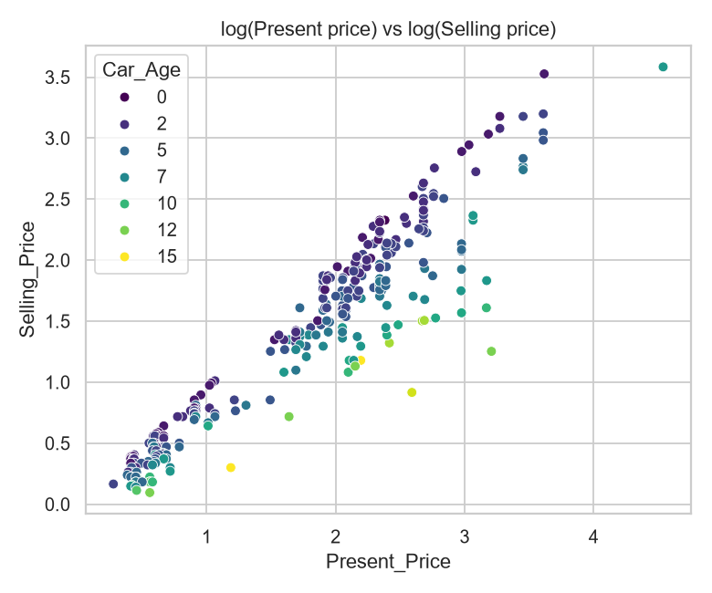
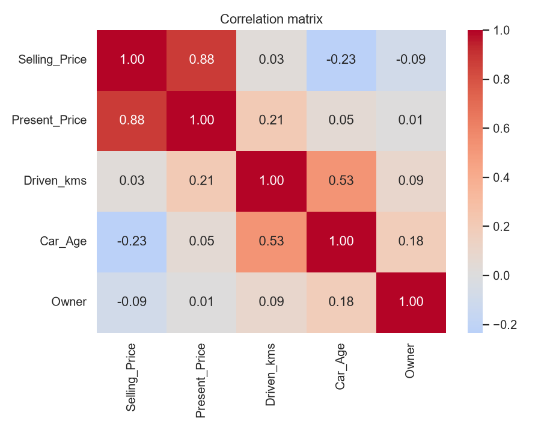

# 🚗 Car Price Prediction

**CodeAlpha Data Science Internship — Task 3**

A machine learning project that predicts the resale (selling) price of a used car or motorcycle, with a web app where anyone can get an instant estimate.

🔗 **Live demo:** https://car-price-prediction-6nco.onrender.com
*(Hosted on Render's free tier, so the first visit after a period of inactivity can take 30–60 seconds to wake up.)*

---

## 📸 Screenshots

| Quick form |Chat assistant |
|---|---|
|  |  |

| Price vs. showroom price (log scale) | Correlation heatmap |
|---|---|
|  |  |

---

## 📖 Overview

Buying or selling a used vehicle is hard without knowing a fair price. This project trains a regression model on 301 real listings and serves it through a website.

You enter details such as the vehicle name, year of purchase, current showroom price, kilometres driven, fuel type, transmission, seller type and number of previous owners. The app returns an **estimated selling price** and a **likely price range**.

**Pipeline in short:**
1. Clean the data (standardise names, fix types, remove duplicates and invalid rows).
2. Explore it (EDA charts and summary statistics).
3. Engineer features (age, log prices, brand, vehicle type, and more).
4. Train and compare four regression models with cross-validation and hyper-parameter tuning.
5. Evaluate on a held-out test set, then refit on all the data.
6. Save the full pipeline and serve it with Flask on Render.

---

## 🛠️ Tech Stack

| Area | Tools |
|---|---|
| Language | Python 3.11 |
| Data handling | Pandas, NumPy |
| Visualisation | Matplotlib, Seaborn |
| Machine learning | Scikit-learn (Pipeline, ColumnTransformer, Ridge, Random Forest, Extra Trees, Gradient Boosting, GridSearchCV, RandomizedSearchCV) |
| Model saving | Joblib |
| Web backend | Flask, Gunicorn |
| Frontend | HTML, CSS, vanilla JavaScript |
| Deployment | Render, GitHub |

---

## 📂 Project Structure

```
car_price_prediction/
├── data/
│   └── car data.csv                    # dataset (301 rows)
├── models/
│   ├── car_price_pipeline_v1.pkl       # saved pipeline (preprocessing + model)
│   └── metrics_v1.json                 # metrics and settings used by the app
├── reports/figures/                    # EDA charts (generated by eda.py)
├── docs/screenshots/                   # screenshots used in this README
├── src/
│   ├── __init__.py
│   ├── preprocess.py                   # cleaning, feature engineering, encoders
│   ├── eda.py                          # exploratory data analysis
│   └── train.py                        # model comparison, tuning, evaluation, saving
├── templates/
│   └── index.html                      # website (form + chat assistant)
├── app.py                              # Flask app
├── requirements.txt
├── render.yaml                         # Render deployment config
└── README.md
```

---

## ⚙️ Features and Functions

### Data cleaning and features: `src/preprocess.py`
| Function | What it does |
|---|---|
| `load_data()` | Reads `data/car data.csv`. |
| `clean_data()` | Standardises text, converts types, drops missing/duplicate/impossible rows. |
| `normalize_name()` | Lower-cases names and collapses extra spaces (`"Bajaj  ct 100"` → `"bajaj ct 100"`). |
| `get_brand()` / `is_bike()` | Derive the **brand** (brand goodwill) and whether the vehicle is a **car or bike**. |
| `engineer_features()` | Builds `Car_Age`, `log_Present_Price`, `log_Driven_kms`, `Kms_per_year`, `Brand`, `Vehicle_Type` and `Model`. |
| `build_preprocessor()` | One-hot encodes categories and optionally scales numbers. |

### Analysis: `src/eda.py`
Prints a data summary and saves 8 charts: target distribution, numeric distributions, outlier boxplots, price by category, numeric vs. price, a log-log relationship plot, a correlation heatmap and average price by brand.

### Modelling: `src/train.py`
| Function | What it does |
|---|---|
| `make_pipeline()` | Preprocessing + model, predicting **log(price)** and converting back to lakh ₹. |
| `evaluate()` | Reports R², MAE and RMSE. |
| `train_and_save()` | Compares models (5-fold CV × 3 repeats), tunes each one, tests the winner on a hold-out set, computes the price-range band from out-of-fold residuals, refits on all rows and saves the model. |

### Web app: `app.py` and `templates/index.html`
| Feature | Description |
|---|---|
| `GET /` | Home page with the **quick form** and the **chat assistant**. |
| `POST /predict` | JSON API that validates the input and returns the predicted price and range. |
| `GET /health` | Health check used by Render. |
| Quick form | One-page form with name suggestions, validation and clear error messages. |
| Chat assistant | Asks one question at a time, with tap-to-choose answers, then shows the estimate. |
| Price range | Shows a likely range (not just a single number) based on cross-validated error. |
| Safe fallbacks | Notes for unseen vehicle names or very new years; retrains automatically if the saved model can't load. |

---

## 📊 Results

Prices in the dataset are in **lakh ₹** (1 lakh = ₹100,000).

| Model | CV R² (before tuning) |
|---|---|
| **Ridge (chosen)** | **0.954** |
| Gradient Boosting | 0.876 |
| Random Forest | 0.884 |
| Extra Trees | 0.840 |

**Chosen model (Ridge, tuned) on the held-out test set:** R² ≈ 0.94 · MAE ≈ 0.77 lakh (about ₹77,000) · RMSE ≈ 1.27 lakh.

Ridge won because used-vehicle depreciation is close to linear on a log scale, and with about 300 rows the simpler model generalises better than tree ensembles.

---

## 🚀 Run Locally

```bash
git clone https://github.com/md-tanjimul-islam/car_price_prediction.git
cd car_price_prediction

python -m venv .venv
.venv\Scripts\activate            # Windows  (Mac/Linux: source .venv/bin/activate)
pip install -r requirements.txt

python -m src.eda                 # optional: generates the EDA charts
python -m src.train               # trains and saves models/car_price_pipeline_v1.pkl
python app.py                     # open http://127.0.0.1:5000
```

> Run `src` modules from the project root with `python -m ...`.

---

## ☁️ Deployment (Render)

- **Build command:** `pip install -r requirements.txt`
- **Start command:** `gunicorn app:app`
- **Environment variable:** `PYTHON_VERSION=3.11.9`
- **Health check:** `/health`

Config is included in `render.yaml`. The `models/` folder is committed so the app starts without retraining.

---

## ⚠️ Limitations

- The dataset is small (301 rows) and a snapshot up to 2018 from India, so estimates for much newer vehicles or unseen models are extrapolations.
- The app gives an indicative estimate, not a formal valuation.

## 🔮 Future Improvements

- Train on a larger and more recent dataset.
- Add more features such as city, condition and service history.
- Show feature-importance explanations for each prediction.

---

## 👤 Author

**Md. Tanjimul Islam** — Data Science Intern at CodeAlpha
GitHub: [md-tanjimul-islam](https://github.com/md-tanjimul-islam)